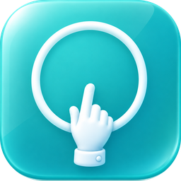
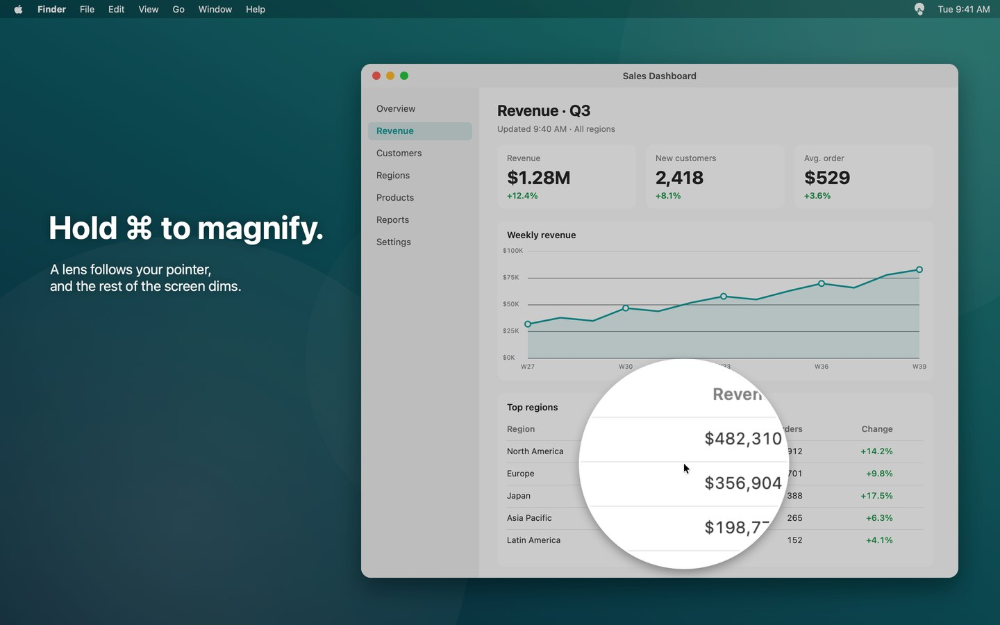
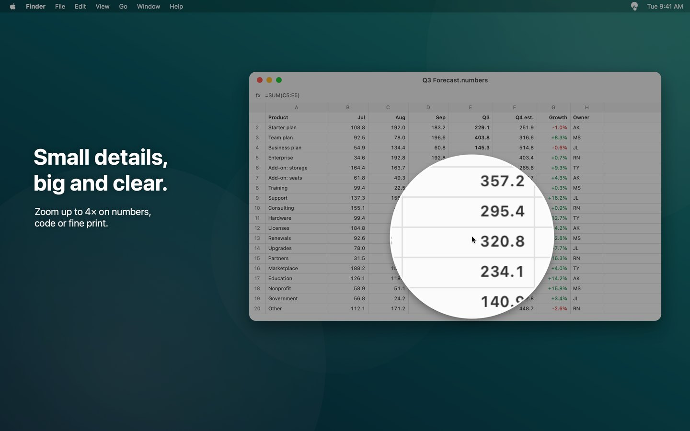
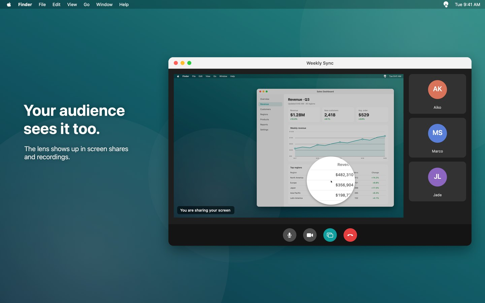
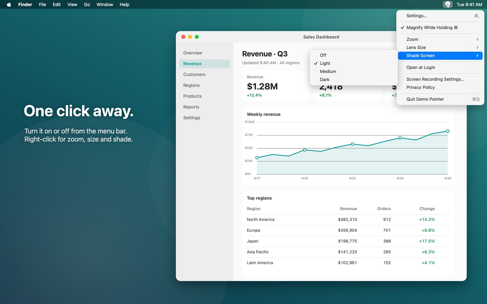
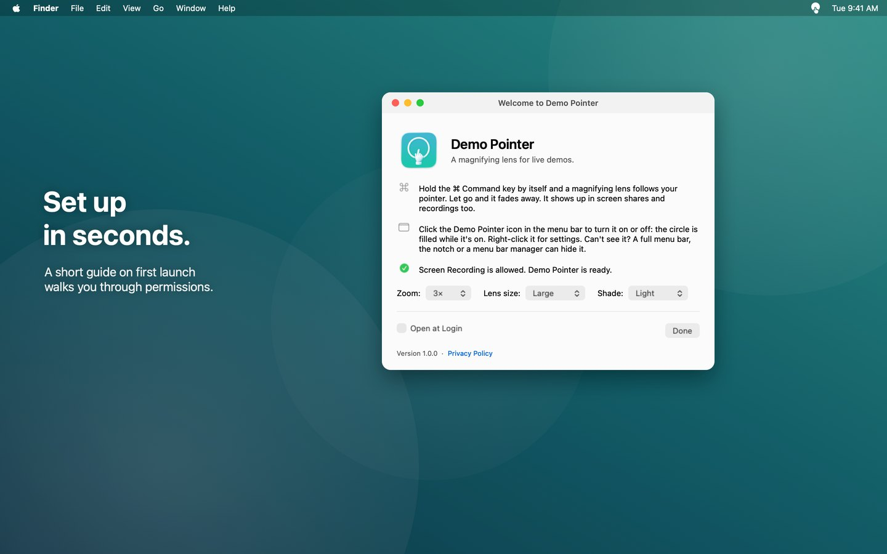

### `Demo Pointer`

Hold <kbd>⌘</kbd> and a magnifying lens follows your cursor. A tiny menu-bar app for product demos, screen shares and recordings.

  <a href="https://github.com/semicolonconsulting/demopointer/releases/latest">Download</a>
  •
  <a href="docs/USAGE.md">How to use</a>
  •
  <a href="docs/BUILDING.md">Build from source</a>
  •
  <a href="PRIVACY.md">Privacy</a>
  •
  <a href="https://github.com/semicolonconsulting/demopointer/releases">Release notes</a>

 

### Why Demo Pointer

- **Hold ⌘, see the detail.** A live, 60 fps zoom of whatever is under the cursor. Let go and it fades away.
- **Your audience sees it too.** The lens shows up in Zoom, Meet and Teams screen shares and in recordings.
- **Spotlight the point.** The rest of the screen dims so the magnified spot stands out.
- **Stays out of the way.** Lives in the menu bar, ignores ⌘ shortcuts like ⌘⇧4, and needs only Screen Recording permission.

<table>
  <tr>
    <td></td>
    <td></td>
  </tr>
  <tr>
    <td></td>
    <td></td>
  </tr>
</table>

### Install

Download `DemoPointer-<version>.dmg` from [Releases](https://github.com/semicolonconsulting/demopointer/releases/latest), open it and drag **DemoPointer** onto **Applications**. Requires macOS 13 Ventura or later.

The first launch asks for Screen Recording access, and GitHub builds aren't notarized yet, so macOS asks you to confirm once. [How to use](docs/USAGE.md) walks through both. A Mac App Store version is on its way.

### Documentation

- [How to use](docs/USAGE.md): features, settings, permissions and troubleshooting
- [Build from source](docs/BUILDING.md): building with Xcode or the command line, and how it works
- [Releasing](docs/RELEASING.md): GitHub and Mac App Store releases
- [Privacy](PRIVACY.md): Demo Pointer never saves or sends what it captures

### Contributing

Found a bug or have an idea? Open an [issue](https://github.com/semicolonconsulting/demopointer/issues). Pull requests are welcome; see [Build from source](docs/BUILDING.md) to get started.

### License

MIT. See [LICENSE](LICENSE).
